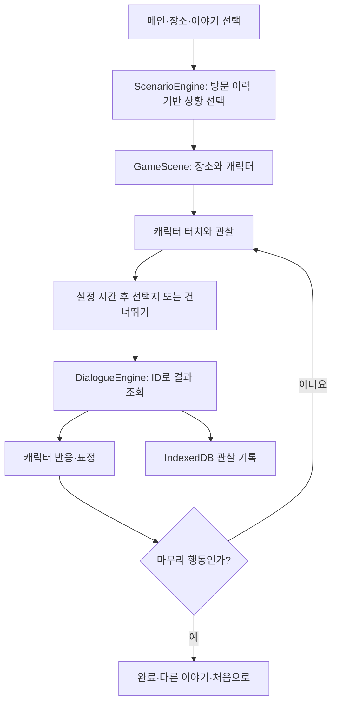

# 구현 계획과 주요 결정

요청 순서에 따라 기반 설정 → 메인·장소 → SVG·Phaser 장면 → 시나리오·대화 엔진 → 변형 엔진 → 4개 에피소드 → 음성 → 부모·기록 → 모바일 보완 → 테스트·배포 준비를 구현했습니다.

## 흐름과 책임

React는 화면·접근성·대화·설정 UI를 담당하고 Phaser는 장면·터치·표정·애니메이션을 담당합니다. 캐릭터 터치에는 DOM 접근성 버튼도 제공합니다. 게임은 브라우저 안에서만 실행하며 백엔드 연결이 없습니다.

상황을 자유롭게 난수로 섞지 않습니다. JSON의 각 변형은 장소·인물·물건·상태·사건·대사·행동·결과를 묶은 검증 단위입니다. 형식 검증과 전체 경로 테스트로 구조 오류를 막고, 사람의 검토로 상황의 의미를 확인합니다.

`VariationEngine`에 난수 함수를 주입할 수 있습니다. 실제 놀이는 `Math.random`, 테스트는 고정 시드를 사용합니다. 표시 배열과 원본 데이터는 분리되어 셔플이 결과를 바꾸지 않습니다.

화면은 그림 지도와 방 안 놀이 선택으로 시작하며, `GameUI`의 물건 조작과 Phaser 장면 반응으로 진행합니다. 자세한 변경은 [놀이 화면 개편](놀이화면-개편.md)을 참고하세요.

선택 시간은 물건 선반이 나타난 시점부터 측정하며 관찰 대기 시간은 제외합니다. 설정에서 선택지 개수를 바꾸면 새 선택지 집합이 나오고 측정도 다시 시작합니다. `repeatCount`는 해당 에피소드를 시작한 횟수이며 중간에 나간 방문도 포함합니다. 기록은 최대 최근 100건을 부모 화면에서 표시합니다.

정답 여부나 점수 대신 행동별 자연스러운 반응을 제공합니다. 휴식 요청을 존중하는 행동은 완료할 수 있고, 도움 제안의 거절은 후속 대화로 이어집니다. 결과를 다시 들을 수 있으며 발화가 없어도 모든 경로를 플레이할 수 있습니다.

## 확장 경계

이야기 추가에는 진행 엔진 수정이 필요하지 않습니다. 새 사물·장소의 시각 표현은 `GameScene`에 별도로 추가합니다. `GameUI`는 대화·선택지·힌트·완료 화면을 담당하고 `App`은 진행 상태와 엔진 연결을 관리합니다.

저장 자료는 순수 객체라 향후 파일 내보내기를 추가하기 쉽습니다. 상황 이력은 영구 저장하지만 표현·표시 위치의 균형 통계는 현재 앱 실행 동안 유지됩니다. 저장 공간 차단 시 놀이를 중단하지 않고 안내와 메모리 이력으로 대체합니다.
